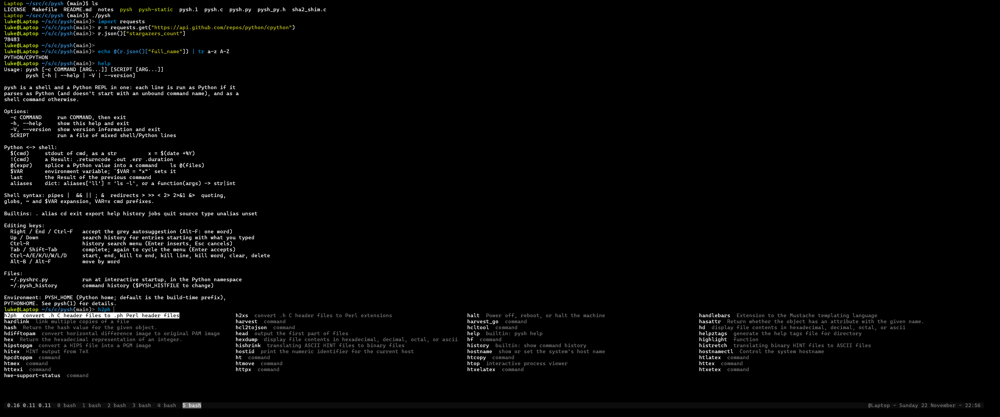

# pysh

A shell and a Python REPL in one executable. Every line is Python if it parses
as Python, and a shell command otherwise. It embeds the CPython that is installed
on your system, so `import` finds the same modules your `python` does.
Python functions can be [stages in a pipeline](#python-in-pipelines), and a pipeline's result can go
straight into a variable.



```
~/src/c/pysh(main)> x = 6 * 7
~/src/c/pysh(main)> x
42
~/src/c/pysh(main)> ls -la | wc -l
12
~/src/c/pysh(main)> files = $(ls).split()
~/src/c/pysh(main)> ps aux | grep ssh | hits=@lines
~/src/c/pysh(main)> cat package.json | @(lambda f: json.load(f)["name"])    # after: import json
```

## Build

```sh
make            # pysh         - dynamic glibc; loads any C extension your python can
make static     # pysh-static  - fully static; no C-extension modules (ssl, sqlite3, lxml...)
make install    # PREFIX=/usr/local by default; also installs the man page
```

Needs `gcc`, `xxd`, and the development files for the Python you want to embed
(`libpython3.x.a`, headers), plus `libexpat`, `zlib` and OpenSSL headers.
`make PYTHON=python3.11` builds against another interpreter. The Python home is baked in
at build time and can be overridden with `PYSH_HOME`.

## Usage

```
pysh                   interactive
pysh -c 'cmd'          run a command string and exit
pysh script [args]     run a file of mixed shell/Python lines (or make it executable, see Scripts)
pysh -e ...            stop at the first failing command (scripts and -c)
pysh --help | --version
```

`help` inside the shell prints the same help; `man pysh` has the full details.

## Python and shell together

| Syntax      | Meaning                                                     |
|-------------|-------------------------------------------------------------|
| `$(cmd)`    | stdout of `cmd` as a `str`                                  |
| `!(cmd)`    | a `Result`: `.returncode .out .err .duration`               |
| `@(expr)`   | splice a Python value into a command (lists become words)   |
| `$VAR`      | environment variable; `$VAR = "x"` sets it                  |
| `![cmd]`    | a `Process` you read while it runs: `for line in ![tail -f log]:` |
| `$[cmd]`    | run attached to the terminal (live; interactive programs work), returns a `Result` |
| `% cmd`     | a leading `%` forces shell mode: `% X=1; make`                      |
| `cmd \| @fn` | a [Python pipeline stage](#python-in-pipelines): `fn` gets a text stream |
| `cmd \| x=@fn` | put the result in `x` (`x=@` keeps the raw text, `x=@tee` also shows it) |
| `last`      | the `Result` of the previous command                        |
| `aliases`   | dict; `aliases["ll"] = "ls -l"` or a function(args)         |

Inside functions, `@(expr)` sees the function's local variables. `$name` in a shell line is an
*environment* variable; use `@(name)` for a Python variable.

A line is treated as a command when it doesn't parse as Python, or when it starts with
a name that isn't bound in Python but is a program, builtin or alias (`ls -la`, `id -u`).

The shell side has pipes (`|`, and `|&` to include stderr), `&& || ; &`, redirects
(`> >> < 2> 2>&1 >&2 &>`), quotes, globs, `~`, `$VAR`, `VAR=x cmd`, brace expansion
(`{a,b}`, `{1..10..2}`, `{01..12}`), arithmetic (`$((1 + 2 * $X))`), here-documents
(`<<EOF`, `<<-EOF`, `<<'EOF'`) and here-strings (`<<< text`). There are no shell loops or
functions; use Python.
Aliases expand wherever a command starts, including after `;`, `&&`, `||` and `|`; `\ls` skips one. An alias ending in a space also expands the
word after it: with `alias sudo='sudo '`, `sudo ll` works.
Builtins: `cd pwd exit export unset alias unalias jobs fg bg wait kill source history type help`.

### Forcing shell mode with `%`

pysh guesses whether a line is Python or shell. A leading `%` removes the guess: the line is a shell
command, whatever it looks like.

```
% export X=5; sh -c 'echo $X'      # one-line assignment + command (this parses as Python otherwise)
% echo 1 + 2                       # prints "1 + 2" instead of evaluating it
```

`%` is only special at the start of a line, so `x % 4` is still modulo. Highlighting and Tab
completion understand it.

### Streaming output

`$(cmd)` and `!(cmd)` wait for the command to finish. To read output while it is still running, use
`![cmd]`, which returns a `Process` immediately:

```python
for line in ![tail -f /var/log/syslog]:          # lines arrive as they are printed
    if "error" in line: print(line)

with ![make -j8] as p:                           # the command is ended if you leave the block early
    for line in p:
        print(line)
print(p.returncode)
```

| `Process` member | |
|---|---|
| iteration, `readline()`, `read()` | lines without the newline / one line / everything left |
| `wait(timeout=None)` | wait for it to exit, return the exit status |
| `poll()`, `.returncode` | status if it has exited, else `None` |
| `terminate()`, `kill()`, `send_signal(sig)` | signal the whole pipeline |
| `.result` | a `Result` (after it has exited) |
| `.pid`, `.timed_out` | |

Standard error stays on the terminal (`sh(cmd, stream=True, merge=True)` folds it into the stream).
`![...]` streams one pipeline; for `;`, `&&` or `&` lists use a normal command line.

`$[cmd]` runs a command attached to the terminal: output is live, interactive programs work
(`$[vim notes.txt]`, `Ctrl-Z` stops them) and you get a `Result` back.

`sh()` is the same machinery with options, for use from Python code:

```python
sh("make", tee=True)                   # show output live and capture it in the Result
sh("deploy.sh", check=True)            # raise ShellError (with .result) on a non-zero exit
sh("curl -s $URL", timeout=10)         # SIGTERM after 10 s, SIGKILL 2 s later; raises subprocess.TimeoutExpired
sh("make", capture=False)              # same as $[make]
sh("tail -f log", stream=True)         # same as ![tail -f log]
```

`timeout` ends the whole process group, so a command that spawns children can't hold the call open.

### Working directory

`$PWD` always matches the real working directory: if the parent process left an unset, relative or
stale `PWD` in the environment (for example a Windows-side path when launched through `wsl.exe`),
pysh corrects it at startup. `cd` keeps symlinks logical like bash (`cd link; cd ..` goes to the
link's parent; `cd -P` resolves them), and `pwd` is a builtin (`pwd -P` for the physical path).

**Job control**: `Ctrl-Z` stops the foreground job, `jobs`/`fg %2`/`bg`/`kill %1`/`wait`
manage it, `cmd &` runs in the background, finished jobs are reported before the next prompt,
and `Ctrl-C` only interrupts the foreground job.

## Python in pipelines

A pipeline stage can be Python. Write `@name` or `@(expression)` where a command would go, and use
`name=@...` to get results straight into variables:

```python
import json
curl -sf https://api.github.com/repos/python/cpython | repo=@json.load
ps aux | grep ssh | hits=@lines
@(sorted(hits, key=len)) | head -3
```

Five forms cover it:

| form | meaning | where |
|---|---|---|
| `... \| @fn` / `@(expr)` | run Python on the stream | any stage |
| `name=@fn` | keep what `fn` returns | last stage |
| `name=@` | keep the raw text | any stage |
| `name=@tee` / `@tee` | keep (or not) and show it as it goes past | any stage |
| `@rows \| ...` | Python as the source | first stage |

### Stages

The function receives a **text stream**, like `sys.stdin`, so many existing functions work unchanged:

```python
cat sales.csv | @pd.read_csv                      # after: import pandas as pd
cat data.json | @json.load                        # json.load, not json.loads (that takes a string)
cat words.txt | @(lambda f: len(f.read().split()))

def errors(stream):                               # a generator streams, so this works on `tail -f`
    for line in stream:
        if "ERROR" in line: yield line
tail -f app.log | @errors | head

def grep_re(stream, pattern):                     # extra words arrive as string arguments
    return (l for l in stream if re.search(pattern, l))
ps aux | @grep_re 'ssh|nginx'
```

| the function returns | what comes out |
|---|---|
| `None` | nothing (it printed for itself; `print` goes to the stage's output) |
| a string or bytes | that text, as is |
| a list, tuple, generator or other iterator | one item per line |
| anything else (dict, DataFrame, number) | its printed form |

`@name` takes a dotted name; use `@(...)` for anything else, such as `@(functools.partial(f, 2))`.
`@(...)` is a stage only if its value is callable. If `cmd` holds the string `"wc"`, then `ls | @(cmd) -l`
still runs the program `wc`.
Redirections work as usual (`@fn < in.txt > out.txt`, `2> err.txt`, `<<<`, here-documents).

### Getting results into variables

```python
curl -sf $URL | data=@json.load                   # the function's result
ls | files=@lines                                 # `lines` is built in: lines without newlines
date | today=@                                    # raw text, trailing newline included
curl -sf $URL | raw=@tee | @json.load             # keep a copy, show it, and parse it
ps aux | all=@ | grep ssh | hits=@lines           # before and after a filter
make 2>&1 | log=@tee | grep -i error
data=@json.load < config.json
```

- The names are **Python** variables in your session, not environment variables.
- Generators and other iterators become lists. At the prompt an assignment prints nothing.
- A returned value you don't assign is also kept in `_` at the prompt, and `!( ... )` has it as `.value`:
  `r = !(cat data.json | @json.load); r.value`.
- `X=@something cmd` (nothing piped into it) and `X='@something'` are still environment assignments.

### When something fails

A variable is **left as it was** if any command before it fails, or its function raises, and the status is
non-zero. So use `curl -f`, which makes an HTTP error count as a failure. A failure *after* a capture doesn't
undo it: in `curl -sf $URL | raw=@ | data=@json.load`, `raw` is set even if the reply isn't JSON.

**Finding nothing is not a failure.** When `grep`, `egrep`, `fgrep`, `zgrep`, `rg`, `ag` or `pgrep` exits 1,
the variable gets the empty value (`[]` from `@lines`, `""` from `name=@`), the status stays 1 so `&&` and `||`
behave, and `-e` carries on:

```python
grep zebra animals.txt | hits=@lines || echo none
```

Add your own such commands with `no_match_commands |= {"mytool"}`. A wrapper hides the command, so
`sudo grep` that finds nothing leaves the variable alone. `sh(..., check=True)` still raises on status 1.

Without a capture, a pipeline's status is its last stage's, so a failing `git` in `git log | @parse` goes
unnoticed. `set_pipefail = True` (in a script or `~/.pyshrc`) makes any stage's failure count; a command
cut off because a later stage stopped reading (`yes | head -1`) doesn't. With `-e` that stops the script.

### Python as the source

```python
rows = ["pear", "apple"]
@rows | sort                                      # a value is written out
@mygen 100 | head                                 # a function is called, with the words as arguments
@(df.to_csv()) | wc -l
```

A line that starts with `@` is a decorator unless it has a `|`, `<` or `>` outside brackets (or words after
`@(...)`), so `@property` and `@lru_cache(maxsize=2)` are unaffected.

### In scripts and functions

Top-level lines of a script use these forms directly. Indented Python blocks hold Python only, so inside an
`if`, loop or function write the pipeline as `$[...]` (output to the terminal) or `!(...)` (captured):

```python
if verbose:
    $[ps aux | procs=@lines]                      # sets the global `procs`

def users():
    return !(cut -d: -f1 /etc/passwd | @lines).value
```

### Things to know

- The **last stage runs in the shell**, so variables it changes stay changed. Earlier stages run in forked
  copies: they stream like any program, but their changes are lost, and they can't use a GPU the shell has
  already initialised (put CuPy work last).
- A pipeline ending in Python or a capture can't be suspended with Ctrl-Z; Ctrl-C interrupts it.
- Captures can't be used with `&` or `![...]`. Captured text is held in memory.
- `sh(..., timeout=...)` stops the programs in a pipeline but can't interrupt Python running in the shell.
- Tab completion and highlighting don't know about `@name` yet.

See `examples/logwatch.sh`, `examples/apipeek.sh` and `examples/inventory.sh`.

## Scripts

Start a file with a shebang and `chmod +x` it:

```python
#!/usr/bin/env pysh
import sys
for host in sys.argv[1:]:
    r = !(ping -c1 -W1 @(host))
    print(host, "up" if r else "down")
```

`sys.argv`, `__file__` and `__name__ == "__main__"` behave as in Python. An uncaught exception
prints a traceback with the real file and line and exits 1; a failing command doesn't stop the
script unless you use `#!/usr/bin/pysh -e` (or `pysh -e script`). A Python block ends at the first
unindented line, so shell lines can follow it directly.

`sys.exit(3)` sets the exit status; `sys.exit("message")` prints the message to standard error and exits 1,
as in Python. Eighteen complete, tested scripts are in [`examples/`](examples/) (disk usage, TLS expiry
checks, flaky-test detection, import graphs, a local-LLM commit-message drafter, a CPU-vs-GPU benchmark with CuPy, and more); each
supports `--help`.

## Interactive features

- **Autosuggestions**: grey text from history. `→`/`End`/`Ctrl-F` accept, `Alt-F` takes a word.
- **Highlighting**: strings yellow, numbers and operators cyan, Python keywords blue, paths underlined. Program names keep the plain colour of their arguments.
- **Tab completion menu** with descriptions: commands from man pages, files by type/size,
  Python attributes by type, flags parsed from `cmd --help`. Tab cycles, Enter runs the selection, Esc cancels.
- **Pasting**: text that arrives in one go (a paste, or typing ahead while a command runs) is inserted in one step and repainted once, so large pastes are fast.
- **`Ctrl-R`** history search menu; `↑`/`↓` search history by prefix.
- **`Alt-E`** edits the line in your editor, for anything longer than a line. See below.
- **Colored `ls`**: interactive shells alias `ls` to `ls --color=auto` when your `ls` supports it (set up by the starter `~/.pyshrc`; edit or delete it there).
- **Prompt**: `user@host ~/src/c/pysh(branch)>`, with the git branch in white.

## Editing in your editor

pysh edits one line at a time. For a loop or a function, press `Alt-E`: the line (with any continuation lines
already typed) opens in `$EDITOR`, which is `vim` unless you set it otherwise.

- **Save and quit** and the block is shown and run at once. It runs like a script, so shell and Python lines
  can be mixed. A single Python statement still prints its values, as if typed.
- **Quit without saving** (`:q!`), save an empty file, or have the editor fail, and nothing runs. What you had
  typed stays in history.
- `↑` brings a block back on one line, with `⏎` marking each line break. Press Enter to run it again, or
  `Alt-E` to edit it. Blocks are kept in history across sessions.

For an editor that returns immediately, use its waiting option, e.g. `export EDITOR="code --wait"`.

## Security notes

- **Flag probing.** Tab on a `-flag` runs `<command> --help` to read the options. This is on by default but
  limited to system programs: found on an absolute `$PATH` entry, with the file, its directory and the `$PATH`
  entry owned by root and not group/world-writable. A relative path (`./tool`), a `.` or empty `$PATH` entry,
  or a program in a directory you can write to is never run. Set `set_pipefail = True                    # a pipeline fails if any stage does
no_match_commands |= {"mytool"}        # exit 1 means "found nothing"
probe_flags = False` in `~/.pyshrc` to turn
  it off.
- **`import` searches the current directory**, as `python` does: in the REPL, `-c` and piped input the first
  `sys.path` entry is `''` (it follows `cd`), and a script file searches its own directory. That is what lets
  you `import` a Cython module or helper file sitting next to you, but it also means a hostile `json.py` or
  `.so` in a directory you work in can be imported. Set `import_cwd = False` in `~/.pyshrc` to turn it
  off for interactive sessions, or `PYSH_IMPORT_CWD=0` in the environment for `-c`, scripts and piped input.
- **Completion never evaluates what you type.** Python attribute completion looks up plain dotted names only
  (no calls, no indexing, no properties).
- **Untrusted text is neutralised.** Directory names, git branch names, history entries, `--help` output and
  error messages are shown with control characters replaced by `?`, so a hostile directory or repository can't
  change your window title or write to the clipboard through your prompt.
- **History is private.** `~/.pysh_history` is created mode 0600 (and tightened if it exists); a command that
  starts with a space is not recorded.
- **Helper programs** (`ls` for the colour check, `whatis` for descriptions) are only taken from absolute
  `$PATH` entries, so a `.` in `$PATH` can't run something from the current directory at startup.
- **Arithmetic is 64-bit** like a real shell (`$((2**63))` wraps), and brace expansion refuses ranges over
  100,000 items or 1,000,000 words, so a script can't be made to hang or exhaust memory by one expression.
- pysh is not setuid and runs with your privileges; `~/.pyshrc` is trusted code. Pasting text that contains
  newlines still runs it line by line (no bracketed paste yet), so be careful pasting from web pages.

## Tests

```sh
make test                      # unittest suite in tests/ (shell, parser, line editor, job control)
PYSH=./pysh-static python3 -m unittest discover -s tests -k Parser
```

The line-editor and job-control tests run pysh on a pty and render its output with a small
VT100 emulator (`tests/term.py`), so they check what a terminal would show, including wrapping.

## Virtualenvs

```
activate            # ./.venv or ./venv
activate ~/envs/ml  # or any virtualenv
deactivate
```

`source .venv/bin/activate` does the same. Activating puts the venv's `bin` on `$PATH`, sets `$VIRTUAL_ENV`,
and makes `import` in pysh use the venv's packages (and hide the system ones, unless the venv was made with
`--system-site-packages`). Starting pysh inside an already activated venv does the same for `import`.

- pysh embeds one Python. A venv made with a different minor version (3.11 against 3.12, say) still gets its
  commands on `$PATH`, but `import` is left alone and pysh says so.
- Names you already imported keep the old objects. Import again after switching.

## Startup options

`pysh -i` reads `~/.pyshrc`, also before `-c` or a script. `-l`/`--login` is accepted, as are combinations
like `-lic`, so that `login`, `ssh`, tmux and editors can start pysh; no separate login file is read.
`pysh --norc` skips `~/.pyshrc`. If a broken one keeps you out, run that from another shell.

## Configuration

Every interactive pysh runs `~/.pyshrc`. If you don't have one, pysh writes a starter file the first time:
it sets up coloured `ls` and lists the settings and a few examples, commented out. An existing file is never
overwritten. Delete it to get a fresh copy. Mix shell and Python in it:

```python
export EDITOR=vim
export PATH=~/bin:$PATH
export TODAY=$(date +%F)
alias ll='ls -l'
import os
if os.path.isdir(os.path.expanduser("~/go")):
    os.environ["GOPATH"] = os.path.expanduser("~/go")
```

It takes the same syntax as a script file, and everything it defines at the top level stays in your
session: imports, variables, functions, lambdas, classes and aliases. `__name__` is `"__main__"` while it
runs, so don't paste in a script's `if __name__ == "__main__": sys.exit(main())` block; that would run it and
leave the shell.

Things to know about `~/.pyshrc`:

- Environment variables need `export`. A bare `NAME=value` line is Python, as in any pysh script.
- An indented Python block holds Python only. Set variables there with `os.environ[...]`, or run a shell
  line with `$[export X=1]`.
- An error is reported and the rest of the file still runs. `exit` leaves the shell, as in bash.
- Only interactive shells read it. Scripts and `-c` inherit the environment of whatever started them.
- It can't import modules from the current directory, whatever `import_cwd` says.
- `source ~/.pyshrc` re-runs it.
- pysh does not read `/etc/profile` or `~/.profile`. If it is your login shell, put anything you need from
  them here.

The settings:

```python
aliases["ll"] = "ls -l"
complete_ignore = (".dll", ".exe")      # suffixes hidden from command completion
complete_ignore_dirs = ("/mnt/c",)      # PATH directories hidden from completion
probe_flags = False                    # don't run `cmd --help` for flag completion (default True)
import_cwd = False                     # don't let `import` search the current directory (default True)
PS1 = "{cyan}{cwd}{reset} $ "          # the prompt, see below
```

### Prompt

`PS1` is a Python string, so assign it (don't `export` it). The starter `~/.pyshrc` holds the default:

```python
PS1 = "{venv}{green}{user}@{host}{reset} {cyan}{cwd}{reset}{white}{branch}{reset}{red}{status}{reset}{grey}>{reset} "
```

| field | |
|---|---|
| `{venv}` | `(name) ` while a virtualenv is active, else empty |
| `{user}` `{host}` | who and where |
| `{cwd}` | working directory, with your home as `~` |
| `{branch}` | `(branch)` inside a git repository, else empty |
| `{status}` | `[N]` when the last command failed, else empty |
| `{red}` `{green}` `{yellow}` `{blue}` `{magenta}` `{cyan}` `{white}` `{grey}` `{bold}` `{reset}` | colours |

Write a literal brace as `{{` or `}}`. `\n` makes a multi-line prompt. For anything computed, use a function; its
result is shown as is:

```python
def PS1(): return $(date +%H:%M) + " > "
```

bash escapes such as `\u` and `\w` are not understood. A broken `PS1` is reported once and the default is shown.

Environment variables: `PYSH_HOME` (Python home, defaults to the build-time prefix), `PYSH_IMPORT_CWD=0` (don't search the current directory when importing),
`PYSH_HISTFILE` (history file, default `~/.pysh_history`), `PYSH_RESIZE=reflow|redraw` (what to assume after a window resize when the terminal can't tell pysh) and `PYSH_TTYLOG=file` (copy everything the
line editor writes to the terminal into `file`, for bug reports about redraw problems).

When a command's output doesn't end in a newline, the next prompt starts on a fresh row and a
reverse-video `%` marks where the output stopped (as in zsh).

## Limitations

- Job control needs Python 3.11+ (`process_group`) and a controlling terminal.
- `make static` cannot import C-extension modules.
- A line being edited can be up to 256 KiB; beyond that the terminal beeps and ignores more input.
- Resizing the window while you type repaints the line in place, once per resize (a drag is coalesced). pysh asks the terminal where the cursor is to tell whether it re-wrapped the old text or left it alone, so it works the same in reflowing terminals (Windows Terminal, VTE, kitty, iTerm2, tmux) and non-reflowing ones (xterm). Only if the terminal doesn't answer, or the answer makes no sense, does it start a fresh prompt below. When part of a long line has already scrolled into the history, that fragment stays there.

## Examples

These mix shell output with Python libraries. Each was run in pysh.

### numpy: file-size percentiles from `stat`

```python
import numpy as np
sizes = np.array($(stat -c %s /usr/bin/*).split(), dtype=int)
np.percentile(sizes, [50, 90, 99]).astype(int)
# array([  14640,  146000, 8635872])
```

### pandas: top memory users from `ps`

```python
import io, pandas as pd
df = pd.read_csv(io.StringIO($(ps -eo comm,rss)), sep=r"\s+")
df.groupby("COMMAND").RSS.sum().nlargest(3)
# COMMAND
# claude        427932
# pysh          168740
# harvest_go    104936
```

### requests: query an API, then hand the result to a shell tool

```python
import requests
r = requests.get("https://api.github.com/repos/python/cpython")
r.json()["stargazers_count"]

echo @(r.json()["full_name"]) | tr a-z A-Z
```

Or the other way round: pipe `curl` into Python.

```
curl -s https://example.com/data.json | python3 -c "import sys,json; print(json.load(sys.stdin)['stars'])"
```

### pwntools: cyclic patterns, assembly and a live process

```python
from pwn import *
context.log_level = "error"

cyclic(24)                                  # b'aaaabaaacaaadaaaeaaafaaa'
cyclic_find(b"faaa")                        # 20

echo @(cyclic(16).decode()) | xxd | head -1 # splice a Python value into a pipeline
# 00000000: 6161 6161 6261 6161 6361 6161 6461 6161  aaaabaaacaaadaaa

disasm(asm("xor eax, eax; ret", arch="amd64"), arch="amd64")
# '   0:   31 c0                   xor    eax, eax\n   2:   c3                      ret'

p = process("/bin/cat")
p.sendline(b"hello"); p.recvline()          # b'hello\n'
p.close()

elf = ELF("/bin/ls", checksec=False)
elf.arch, elf.pie, hex(elf.entry)           # ('amd64', True, '0x6d30')
```

## License

MIT; see [LICENSE](LICENSE).
